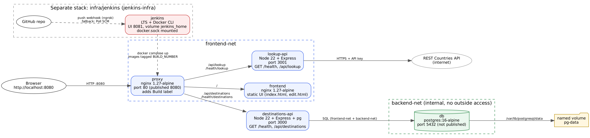

# Travel Bucket List (SYSIN Final Project)

Containerized travel bucket list: nginx proxy, static frontend, two Node.js APIs and PostgreSQL, deployed automatically by Jenkins on every push.

## Team
| Role | Member | Owns |
|---|---|---|
| Project Lead / Scrum Master | _name_ | README, task board, demo flow |
| DevOps / CI-CD Engineer | _name_ | `Jenkinsfile`, `infra/jenkins/`, webhook |
| Infrastructure Engineer | _name_ | `docker-compose.yml`, `*/Dockerfile`, `proxy/`, `docs/architecture.*` |
| Backend and Database Engineer | _name_ | `destinations-api/`, `lookup-api/`, `db/init.sql`, unit tests |
| Frontend, QA and Documentation Lead | _name_ | `frontend/`, `scripts/smoke-test.sh`, `docs/`, slides |

## Which folder is which
| Folder / file | What it is | Port |
|---|---|---|
| `proxy/` | nginx, the only public entry point. Routes `/`, `/api/destinations`, `/api/lookup`, `/health*`. Adds the "Build N" label | 80 (published 8080) |
| `frontend/` | nginx serving the UI files in `frontend/src` (unchanged from the original project) | 80 |
| `destinations-api/` | CRUD for destinations on PostgreSQL, `GET /health`, unit tests | 3000 |
| `lookup-api/` | Country search through REST Countries, `GET /health`, unit tests | 3001 |
| `db/` | PostgreSQL 16 image + `init.sql` (schema and seed) | 5432 (internal only) |
| `infra/jenkins/` | Jenkins in its own compose stack | 8081 |
| `scripts/` | `smoke-test.sh` (used by pipeline), `rollback.sh` | - |
| `Jenkinsfile` | Pipeline as code | - |

Debugging order: browser -> `proxy` logs -> `destinations-api` / `lookup-api` logs -> `db` logs. Use `docker compose logs <service>`.

## Architecture


Networks: `frontend-net` (proxy, frontend, both APIs) and `backend-net` (internal, only destinations-api and db). Only the proxy publishes a port. Data lives in the named volume `pg-data`.

## Prerequisites
Git, Docker with Compose v2, 8 GB RAM recommended. Check with `docker version`, `docker compose version`, `git --version`.

## Run the app (no Jenkins)
```
cp .env.example .env        # then edit .env: set DB_PASSWORD and RESTCOUNTRIES_API_KEY
docker compose up -d --build
docker compose ps           # wait until everything is healthy
```
Open http://localhost:8080. The bottom-right label shows the build number (`Build dev` when started by hand).

Stop without losing data: `docker compose down`. Delete data too: `docker compose down -v` (do not do this before a demo).

## Tests
```
docker build --target test ./destinations-api
docker build --target test ./lookup-api
```
Or locally: `cd destinations-api && npm ci && npm test`. A failing test makes `docker build` fail, which stops the pipeline before Deploy.

## Jenkins setup
1. `cd infra/jenkins && docker compose up -d --build`
2. Unlock password: `docker exec jenkins cat /var/jenkins_home/secrets/initialAdminPassword`
3. Open http://localhost:8081, install suggested plugins, then install **Docker Pipeline** (and **GitHub** plugin if missing). Create the admin user.
4. Check `docker exec jenkins docker ps` lists containers.
5. Manage Jenkins > Credentials > Global > Add: kind **Secret file**, ID `travelbucket-env`, upload your real `.env`. If the repo is private also add a GitHub token credential.
6. New Item > **Pipeline** > Pipeline script from SCM > Git > repository URL, branch `*/main`, Script Path `Jenkinsfile`. Tick **GitHub hook trigger for GITScm polling**.
7. Click **Build Now once** (needed so Jenkins registers the triggers and the `ROLLBACK_TAG` parameter). Build 1 should go all green.

## Automatic trigger
**A. Webhook (preferred):** `ngrok http 8081`, then in GitHub: Settings > Webhooks > Add. Payload URL `https://<ngrok-url>/github-webhook/`, content type `application/json`, event: push. Check GitHub shows a green tick on the ping.
**B. Poll SCM (fallback, already in the Jenkinsfile):** checks every 5 minutes (`pollSCM('H/5 * * * *')`). Lower it to `H/2` for demos.
Either way a `git push` starts the pipeline with nobody pressing Build Now.

## Pipeline
Checkout -> Test (`docker build --target test` for both APIs) -> Build Images (tagged with the build number) -> Deploy (`docker compose up -d --no-build`) -> Smoke Test (`scripts/smoke-test.sh`). Secrets come from the Jenkins credential and the `.env` copy is deleted in `post { always }`.

## Rollback
- Jenkins: **Build with Parameters**, set `ROLLBACK_TAG` to an older successful build number (skips Test/Build, redeploys that tag).
- Shell: `./scripts/rollback.sh 12` (same as `TAG=12 docker compose up -d --no-build`).

## Demo script
See `docs/DEMO-SCRIPT.md`. What was wrong in the original and what changed: `docs/AUDIT.md`. Skeleton for the PDF: `docs/technical-documentation.md`.

## Security notes
- `.env` is git-ignored; only `.env.example` is committed. Never commit the real API key or DB password.
- Jenkins mounts `/var/run/docker.sock` and runs as root: lab-only. Safer options: dedicated build agents, rootless Docker, Docker-in-Docker with TLS, Kaniko.
